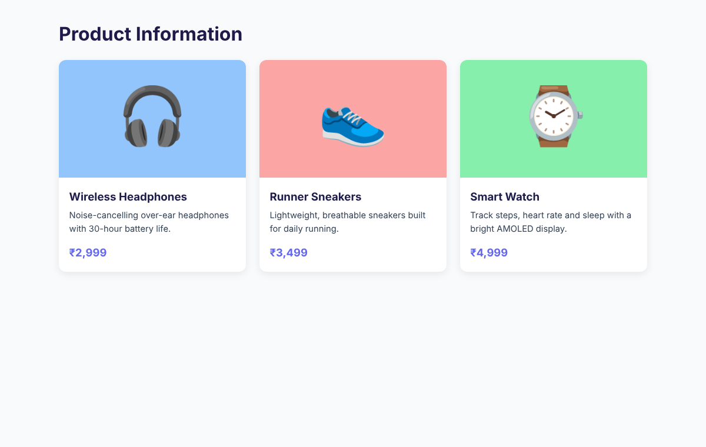
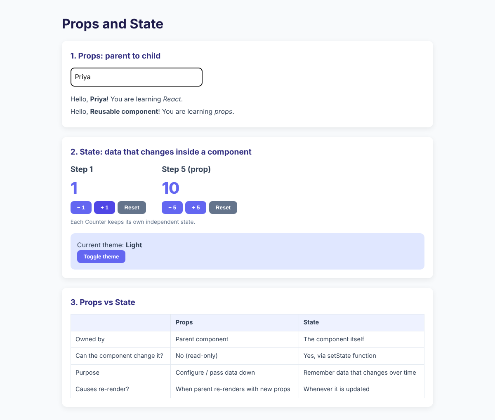
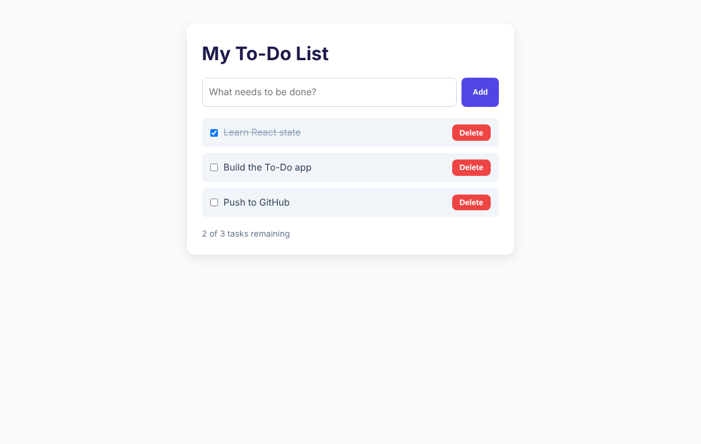
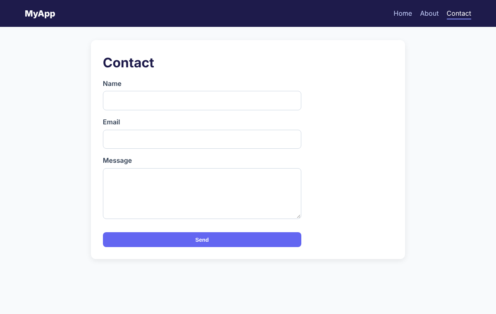
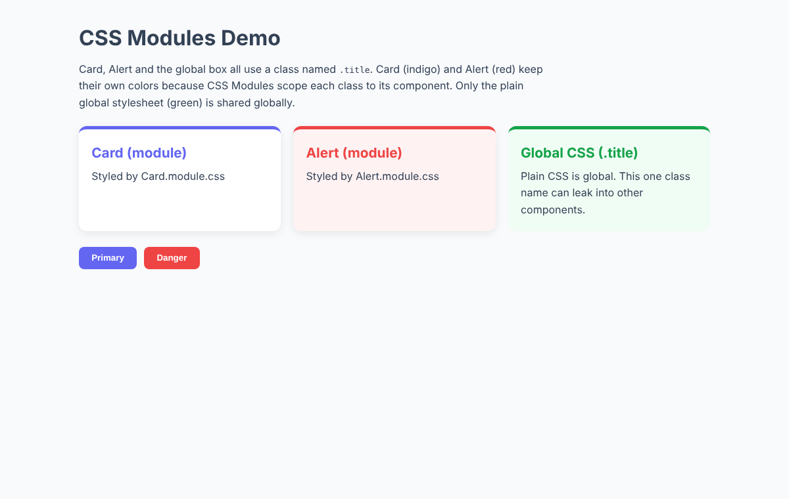
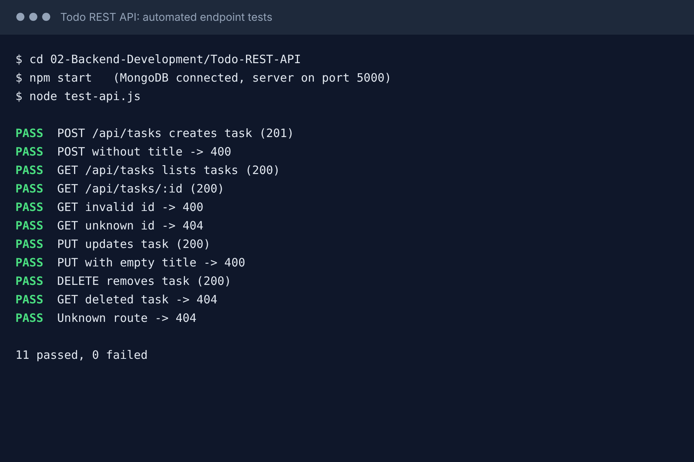
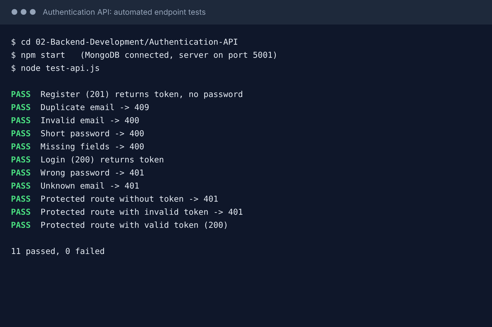
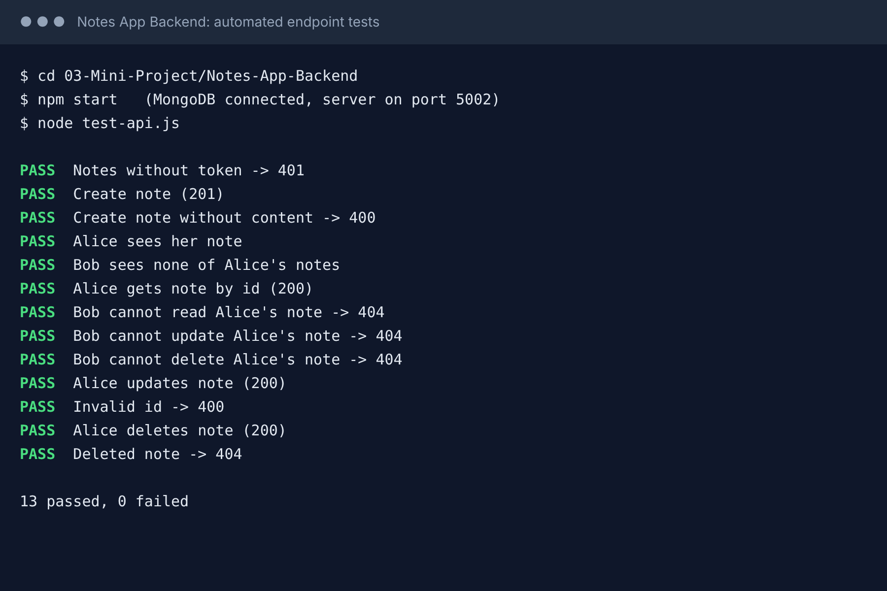

# MERN Stack Internship – Week 2: React Fundamentals and Backend Development

## Overview
Week 2 has two parts:
1. **React fundamentals:** five small Vite apps (components, props/state, To-Do, Router, CSS Modules).
2. **Backend development:** Node.js, Express and MongoDB (Mongoose) REST APIs, with JWT authentication and bcrypt password hashing, ending in a Notes App backend mini project.

## Technologies
React 18, Vite, React Router, CSS Modules · Node.js, Express 5, MongoDB, Mongoose, JWT (`jsonwebtoken`), bcrypt, dotenv, cors · Postman

## Folder structure
```
MERN-Week-2/
├── 01-React-Fundamentals/
│   ├── Product-Component/   Task 1: reusable product card (name, image, price, description)
│   ├── Props-State/         Task 2: props, useState, and a props-vs-state table
│   ├── Todo-App/            Task 3: add, delete, toggle tasks; empty input blocked
│   ├── React-Router/        Task 4: Home, About, Contact pages with NavLink navbar
│   └── CSS-Modules/         Task 5: scoped *.module.css styles
├── 02-Backend-Development/
│   ├── Todo-REST-API/       Task 1: CRUD tasks in MongoDB
│   └── Authentication-API/  Task 2: register, login, JWT, protected route
├── 03-Mini-Project/
│   └── Notes-App-Backend/   Authenticated notes CRUD, each user sees only their own notes
├── postman/                 Importable Postman collections (one per backend)
├── screenshots/
├── POSTMAN-TESTING.md       Endpoints, headers, bodies, expected responses
└── README.md
```
Each backend uses the same layout: `config/` (database connection), `models/` (Mongoose schemas), `controllers/` (logic), `routes/` (URL mapping), `middleware/` (auth, errors), `server.js`, `.env`, `.gitignore`.

## Installation
You need Node.js 18+ and MongoDB (local install, or a free MongoDB Atlas URI).
```bash
node -v && npm -v
mongod --version     # or use MongoDB Atlas
```

## Running the React projects
```bash
cd 01-React-Fundamentals/Todo-App      # or any other React folder
npm install
npm run dev
```

## Running the backends
```bash
cd 02-Backend-Development/Todo-REST-API   # or Authentication-API, or 03-Mini-Project/Notes-App-Backend
npm install
cp .env.example .env                       # Windows: copy .env.example .env
# edit .env: set MONGO_URI and a long random JWT_SECRET
npm start
```
| Project | Port | Default database |
|---|---|---|
| Todo-REST-API | 5000 | week2_todo |
| Authentication-API | 5001 | week2_auth |
| Notes-App-Backend | 5002 | week2_notes |

Secrets live only in `.env`, which is git-ignored. Only `.env.example` is committed.

## API endpoints
**Todo REST API**
| Method | Endpoint | Purpose |
|---|---|---|
| POST | `/api/tasks` | Create a task |
| GET | `/api/tasks` | List all tasks |
| GET | `/api/tasks/:id` | Get one task |
| PUT | `/api/tasks/:id` | Update a task |
| DELETE | `/api/tasks/:id` | Delete a task |

**Authentication API** and **Notes App Backend** (auth routes)
| Method | Endpoint | Access |
|---|---|---|
| POST | `/api/auth/register` | Public. Returns JWT |
| POST | `/api/auth/login` | Public. Returns JWT |
| GET | `/api/auth/me` | Needs `Authorization: Bearer <token>` |

**Notes App Backend** (all need a Bearer token)
| Method | Endpoint | Purpose |
|---|---|---|
| POST | `/api/notes` | Create a note |
| GET | `/api/notes` | List the logged-in user's notes |
| GET | `/api/notes/:id` | Get one of your notes |
| PUT | `/api/notes/:id` | Update your note |
| DELETE | `/api/notes/:id` | Delete your note |

## How security works
- Passwords are hashed with bcrypt before saving (stored values start with `$2b$`). Plain-text passwords are never stored, and the password field is excluded from query results.
- Login returns a signed JWT. The `protect` middleware verifies it on private routes.
- Every notes query filters by the logged-in user's id, so one user cannot read, edit or delete another user's notes (they get 404).

## Testing
- **Postman:** import the files from `postman/` and follow `POSTMAN-TESTING.md`.
- **Automated smoke tests:** start a server, then run `node test-api.js` in that folder (35 checks across the three backends).
- **Manual React checks:** run `npm run dev`; try an empty To-Do submit, add/delete, and the Router links.

## Screenshots
| React | |
|---|---|
|  |  |
|  |  |
|  | |

Backend automated test output:





> Add your own Postman screenshots in `screenshots/` (for example `postman-register.png`, `postman-create-note.png`) and reference them here.

## Submission checklist
- [ ] `.env` files are not included (only `.env.example`)
- [ ] `node_modules` and `dist` folders removed
- [ ] Postman screenshots added
- [ ] Repo pushed to GitHub / zip uploaded to Google Drive with "Anyone with the link" access
