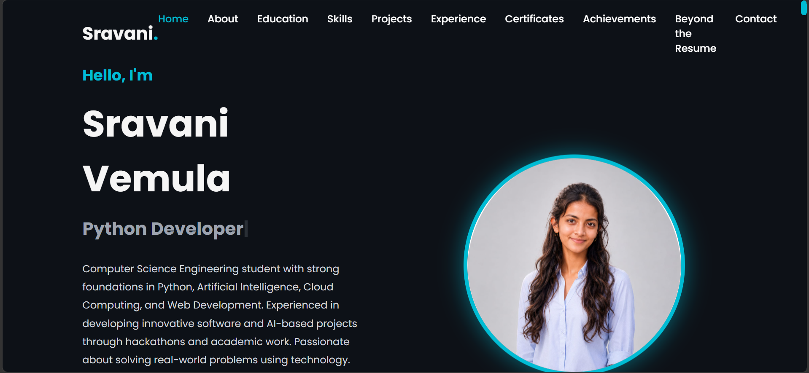
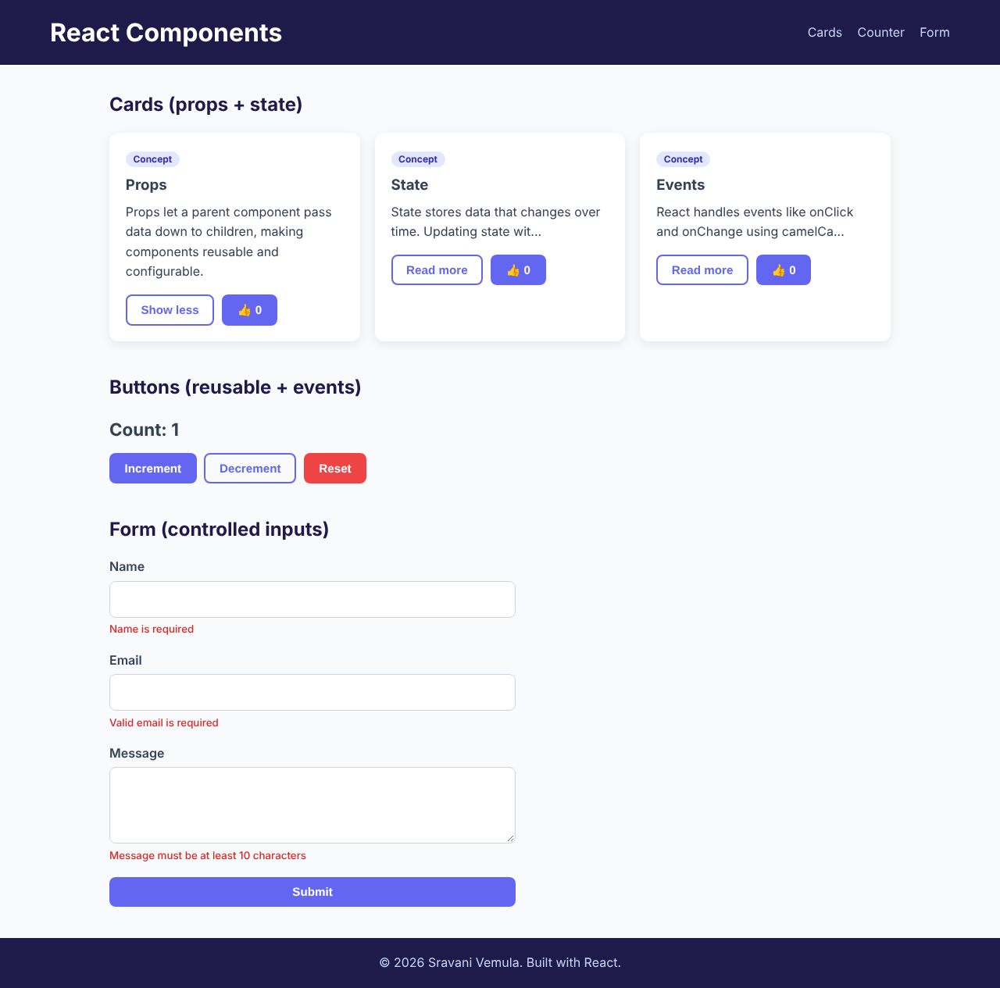
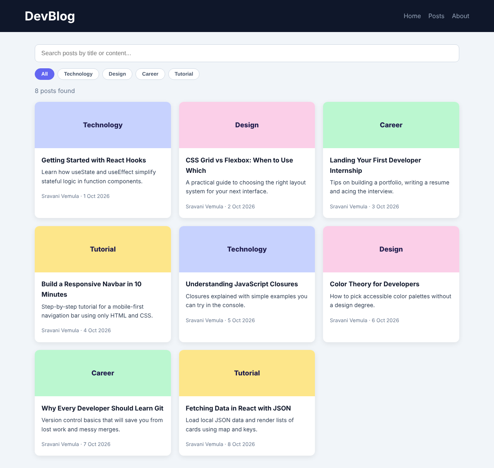

# MERN Stack Internship – Week 1: Frontend Fundamentals

HTML5, CSS3 (Flexbox, Grid, responsive design), JavaScript ES6+ and React basics (components, props, state, events).

## Structure
| Folder | Task | Description |
|---|---|---|
| `01-Portfolio` | Assignment 1 | Responsive personal portfolio (About, Education, Projects, Contact) with mobile menu and form validation |
| `02-React-Components` | Assignment 2 | 5 reusable components: Header, Footer, Card, Button, Form, using props and state |
| `03-React-Blog` | Mini Project | Blog UI rendering cards from `blogs.json`, with live search and category filter |
| `04-Practice-Exercises` | Practice set | Responsive Navbar, Form Validation, E-commerce Landing Page, Flexbox/Grid layouts |

## How to run
**Static projects** (`01-Portfolio`, `04-Practice-Exercises/*`): open `index.html` in a browser.

**React projects** (`02-React-Components`, `03-React-Blog`):
```bash
cd 02-React-Components   # or 03-React-Blog
npm install
npm run dev
```

## Screenshots
| Portfolio | Components | Blog |
|---|---|---|
|  |  |  |

## Learning outcomes
- Semantic HTML and responsive layouts with Flexbox/Grid and media queries
- Reusable React components configured through props
- State with `useState`, controlled form inputs, event handling
- Derived data (search + filter) using `useMemo` over JSON data
